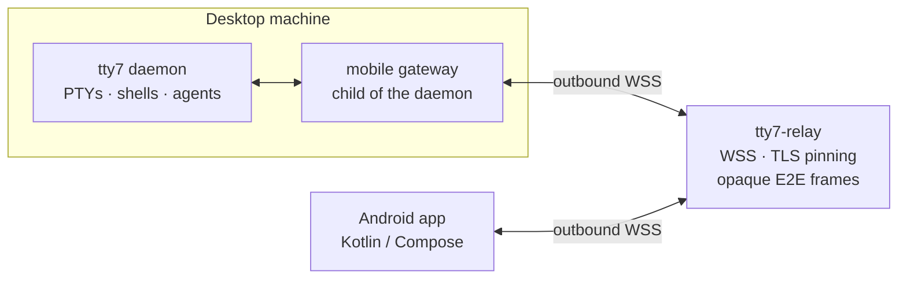

<div align="center">


<h1>tty7-plus</h1>

**A terminal workbench for the desktop — and now the phone.**

<sub>Fork of tty7 · Pure Rust · GPU rendering on Zed's gpui · VT core from Alacritty</sub>

<br />

[](https://github.com/l0ng-ai/tty7)
[](https://www.rust-lang.org)
[](#requirements)
[](#android-app)
[](LICENSE)

<sub>English · [简体中文](README.zh-CN.md)</sub>

<br />

<a href="assets/tour.mp4"></a>

<sub>▶ <a href="assets/tour.mp4">Watch in full quality</a></sub>

</div>

> [!IMPORTANT]
> **tty7-plus is a community fork of [l0ng-ai/tty7](https://github.com/l0ng-ai/tty7).**
> It is not affiliated with the upstream project. Upstream's automatic updater is
> disabled here, because an upstream package would replace the fork and discard its
> changes. This repository does not publish desktop installers yet — build from
> source. See [Upstream and maintenance](#upstream-and-maintenance).

## Why this fork

tty7 keeps your shells in a background daemon instead of in a window: close the
window, keep your sessions. That design already makes it a good place to work
with coding agents and remote machines.

tty7-plus keeps that foundation and adds a first-class path from a phone to the
same daemon, with a self-hosted relay of its own. It also folds in a set of
workflow changes that make the desktop UI quicker to drive: region shortcuts,
an external-editor handoff, and file-tree and layout preferences that persist.

## What's new in tty7-plus

### Android remote terminals

A native Kotlin Multiplatform Compose app in [`mobile/app`](mobile/app) watches
and drives the desktop's panes and agents.

- **Pairing** — Desktop **Settings → Pair Devices** generates a five-minute QR
  code. The phone scans it, compares the verification code, and the desktop
  approves the device explicitly. Before approval the phone can neither list
  sessions nor send input.
- **One phone, one computer** — the app remembers its approved computer and
  reconnects automatically on launch and foreground return. Unpairing is
  confirmed before a different computer can be scanned.
- **Live terminal state, not a replay** — the daemon mirrors the screen with the
  same terminal engine the desktop uses. The phone receives a current-screen
  snapshot and revision-based row patches, then loads older history in bounded
  pages. It does not replay historical ANSI output.
- **A phone-sized PTY** — the shared terminal follows the phone's measured grid,
  including soft-keyboard viewport changes. Desktop take-back restores the
  desktop grid without ending the process.
- **Session management** — create and switch workspaces, create terminals, and
  close terminals after confirmation. Closing a terminal ends its shell and
  whatever runs in it, exactly as the dialog says.
- **Agent-aware UI** — repository grouping, branch and agent status, brand marks
  for supported agents, and live agent output in the session drawer.
- **Chinese-first interface** with light and dark themes, a two-row key bar
  (Enter/CR, Ctrl-J/LF, Esc, Ctrl-C, arrows, and an overflow menu), and precise
  1:1 history scrolling.
- **Full-screen programs** — vertical gestures coalesce remote wheel input, and
  native keys cancel queued scrolling. Codex returns to latest with Esc; OMP and
  ordinary terminals get a return-to-bottom action beside the history status.
- **No GUI required on the desktop** — the daemon and its relay connection keep
  running after the desktop window is closed. Pairing and revocation remain
  desktop-side operations.

### Self-hosted relay

Phones reach the daemon through [`tty7-relay`](crates/tty7-relay), a small Rust
WebSocket relay you deploy yourself.

- **TLS only** — production connections must use `wss://`. Plain `ws://` is
  accepted only on an explicitly bound loopback address for development.
- **Certificate pinning** — the desktop stores the SHA-256 fingerprint of the
  relay's leaf certificate. The initial empty pin fails closed; it does not
  trust a self-signed relay automatically.
- **End-to-end encryption** — pairing derives directional AES-256-GCM keys with
  HKDF. The relay forwards opaque frames and cannot read terminal contents.
- **Bounded by design** — connection, host, client, queue, and frame sizes are
  capped; the process is intended to run comfortably under a 256 MiB memory
  limit.
- **Operational hooks** — `/healthz` returns relay health, and
  [`scripts/relay/tty7-relay.service`](scripts/relay/tty7-relay.service) is a
  hardened systemd unit with `DynamicUser` and `LoadCredential`.

> [!NOTE]
> No relay address, certificate, or fingerprint is bundled with this repository.
> The default `wss://relay.example.invalid:8443/v1/ws` is a reserved placeholder
> that does not resolve. You must supply your own relay and its pin.

### Desktop workflow changes

- **Region shortcuts** — <kbd>Ctrl 1</kbd> sidebar, <kbd>Ctrl 2</kbd> terminal
  area, <kbd>Ctrl 3</kbd> code panel, <kbd>Ctrl 4</kbd> right panel. The four
  regions animate their width over 140 ms as they open and close. These are
  window-chrome bindings, so <kbd>Ctrl 2</kbd>–<kbd>Ctrl 4</kbd> no longer send
  NUL, ESC, and FS to the shell; each can be remapped or unbound in
  **Settings → Keybindings** (or `keybindings` in `config.json`).
- **External editors** — **Settings → General → Editor → File open method** can
  open local files in the built-in editor (default), Helix (`hx`), or Vim
  (`vim`). Search hits pass a line and column; files on remote hosts always use
  the built-in editor.
- **Global document layout** — **Document layout** chooses **Dock beside
  terminal** or **Fill window** for every tab and window, and persists across
  relaunches.
- **Dotfiles in the Files panel** — an eye in the panel title bar shows or hides
  dotfiles, and the choice is remembered as `files_show_hidden`.
- **Agent marks in the workbench** — agent icons and status are visible in tabs
  and the sidebar, matching the phone's agent badges.
- **No upstream updates** — update checks, downloads, and installation are
  disabled at the code level and in the default configuration. Update the fork
  by rebuilding it.

## Architecture



Both the desktop and the phone make outbound connections, so neither needs a
public port or a VPN. The relay only forwards frames between them; TLS pinning
protects the relay leg, and end-to-end encryption protects the terminal payload
across it.

The rest of the workbench is unchanged: the GUI is a client of the same local
daemon, and remote workspaces run that daemon on another machine over SSH.

## Requirements

| | |
|---|---|
| **Desktop build** | Rust **1.95** or newer (edition 2024). The pinned GPUI dependency uses `cold_path`. |
| **Desktop runtime** | macOS 14+ · Windows 10/11 · Linux with X11 or Wayland |
| **Linux build packages** | `pkg-config cmake clang libxkbcommon-dev libxkbcommon-x11-dev libfontconfig1-dev libfreetype6-dev libwayland-dev libx11-dev libxcb1-dev libzstd-dev libssl-dev libkrb5-dev` |
| **Android build** | JDK 17, Android SDK 35, `ANDROID_HOME` set. The Gradle wrapper is committed. |
| **Android runtime** | Android 8.0 (API 26) or newer |
| **Relay host** | Any Linux host with a public TCP port (default `8443`) and a TLS certificate for the relay's hostname |

## Install

### Desktop from source

```bash
git clone https://github.com/monsoon1360/tty7-plus.git
cd tty7-plus
rustup toolchain install 1.95.0
cargo +1.95.0 build --release
./target/release/tty7-app
```

The build produces:

| Binary | Purpose |
|---|---|
| `target/release/tty7-app` | The GUI, and the background daemon (`--daemon`) |
| `target/release/tty7` | The console CLI, a client of the local daemon |
| `target/release/tty7-server` | The lean server used for remote workspaces |
| `target/release/tty7-relay` | The mobile relay |

`tty7-app` starts the daemon on first launch. To use the CLI from a source build:

```bash
export PATH="$PWD/target/release:$PATH"
tty7 --version
```

On Linux, install the build dependencies first:

```bash
sudo apt-get update
sudo apt-get install -y pkg-config cmake clang \
  libxkbcommon-dev libxkbcommon-x11-dev \
  libfontconfig1-dev libfreetype6-dev \
  libwayland-dev libx11-dev libxcb1-dev \
  libzstd-dev libssl-dev libkrb5-dev
```

Release packaging scripts for macOS, Windows, Linux, and AppImage live in
[`.github/scripts`](.github/scripts). They are the scripts CI uses; inspect the
header of each script for its arguments and signing prerequisites.

To update a source install, pull and rebuild, then restart the daemon so it runs
the new binary:

```bash
git pull --ff-only
cargo +1.95.0 build --release
```

Quit tty7 with **Quit and Stop Server** from the tray/menu-bar menu, then launch
the new build. Stopping the server ends every process running in the panes.

### Android app

```bash
cd mobile

# JDK 17 and Android SDK 35 must be installed, and ANDROID_HOME must point at
# the SDK directory.
./gradlew :app:assembleDebug

adb install -r app/build/outputs/apk/debug/app-debug.apk
```

The debug APK is at `mobile/app/build/outputs/apk/debug/app-debug.apk`. The app
id is `io.tty7.mobile`, `minSdk` is 26, and `compileSdk`/`targetSdk` are 35.
The legacy Tauri/iroh client in [`mobile/src-tauri`](mobile/src-tauri) is kept
for development only; **Settings → Pair Devices** and the native Android app do
not use its `tty7pair:` protocol.

### Relay server

Build the relay and install it with its credentials:

```bash
cargo +1.95.0 build --release -p tty7-relay

sudo install -Dm755 target/release/tty7-relay /opt/tty7-relay/tty7-relay
sudo install -Dm600 /path/to/fullchain.pem  /opt/tty7-relay/tls.crt
sudo install -Dm600 /path/to/privkey.pem    /opt/tty7-relay/tls.key

sudo install -Dm644 scripts/relay/tty7-relay.service \
  /etc/systemd/system/tty7-relay.service

sudo systemctl daemon-reload
sudo systemctl enable --now tty7-relay.service
```

The unit listens on `0.0.0.0:8443`, runs as a `DynamicUser`, and passes the
certificate and key through systemd credentials. Replace the binary or TLS files
and restart the unit:

```bash
sudo systemctl restart tty7-relay.service
```

Allow inbound TCP `8443` on the relay only. Verify it with the trusted
certificate, never by disabling TLS verification:

```bash
curl --cacert /path/to/ca.pem https://relay.example.com:8443/healthz
# {"status":"ok","protocol":1}
```

Compute the SHA-256 pin that the desktop needs:

```bash
openssl x509 -in /opt/tty7-relay/tls.crt -noout -fingerprint -sha256 \
  | cut -d= -f2 | tr -d ':' | tr 'A-F' 'a-f'
```

The relay can also be run directly for a quick check:

```bash
target/release/tty7-relay \
  --listen 0.0.0.0:8443 \
  --cert /path/to/fullchain.pem \
  --key /path/to/privkey.pem
```

`--cert`/`--key` have `TTY7_RELAY_CERT`/`TTY7_RELAY_KEY` equivalents, and
`--listen` has `TTY7_RELAY_LISTEN`. Plain `ws://` is refused outside an explicit
loopback bind made with `--allow-insecure-loopback`, which exists for local
development only.

> [!WARNING]
> Never commit a certificate, private key, pairing QR code, device credential,
> or relay fingerprint to the repository. Provision them on the server and enter
> the pin on the desktop out of band.

## Pair a phone

1. On the desktop, open **Settings → Pair Devices**.
2. Enter your relay URL, for example `wss://relay.example.com:8443/v1/ws`, and
   the 64-character hexadecimal SHA-256 pin of its leaf certificate.
3. Enable mobile access. An empty pin is rejected rather than trusted.
4. Generate the QR code. It expires after five minutes.
5. On Android, open **扫描与配对管理**, grant camera permission if asked, and
   scan the code.
6. Compare the verification code on the phone with the request shown on the
   desktop, then approve that device on the desktop.
7. Open the session drawer and choose a terminal. The terminal syncs to the
   phone's grid; tap it to type at the cursor.

To withdraw access, revoke the device on the desktop. Disabling mobile access
disconnects live phones and stops relay access. Unpairing on the phone removes
its saved credential; it does not by itself revoke the desktop-side entry.

## Configuration

Configuration lives in `config.json` (see
[configuration reference](docs/reference/configuration.mdx)). The fork adds or
changes these keys:

| Key | Values | Default | Effect |
|---|---|---|---|
| `files_show_hidden` | bool | `false` | Show dotfiles and dot-directories in the Files panel. Persisted when toggled. |
| `file_open_with` | `"built_in"`, `"helix"`, `"vim"` | `"built_in"` | Editor used for files picked in the tree, quick open, and search results. Remote files always use the built-in editor. |
| `document_layout` | `"dock"`, `"fill"` | `"dock"` | Global layout for the built-in editor and diff view, shared by all tabs and windows. |
| `check_for_updates` | bool | forced `false` | Retained for config compatibility; upstream update checks are disabled. |
| `auto_download_updates` | bool | forced `false` | Retained for config compatibility; upstream downloads are disabled. |

## Security and privacy

- **No shipped relay trust.** This repository contains no deployment address and
  no certificate fingerprint. The placeholder host `relay.example.invalid` is
  reserved and never resolves.
- **Pinning plus end-to-end encryption.** The relay leg is pinned to a leaf
  certificate; terminal payloads are separately encrypted between the phone and
  the desktop. The relay can observe connection metadata such as IP addresses
  and timing, not terminal contents.
- **Credentials stay local.** The desktop stores mobile credentials in a private
  file under its config directory, not in general settings. Android stores its
  secret with Android Keystore.
- **Explicit approval.** A pairing request grants nothing until a person at the
  desktop approves it. Pairing codes expire after five minutes and are
  single-use.
- **No upstream telemetry or updates.** There are no accounts, analytics,
  advertising, or tracking. The upstream update client is disabled.
- **Reporting a vulnerability.** Use
  [private vulnerability reporting](https://github.com/monsoon1360/tty7-plus/security/advisories/new)
  on this repository; do not open a public issue for a security problem.

The inherited privacy policy in [`PRIVACY.md`](PRIVACY.md) still describes the
legacy iroh-based development client. The authoritative description of the
native Android path is
[docs/remote/workspaces.mdx](docs/remote/workspaces.mdx#android-remote-terminals).

## Inherited from tty7

- **Persistent sessions** — shells and panes belong to a background daemon;
  quitting the window does not kill them. Layout and screen contents survive a
  reattach, and supported agents resume their conversations after a reboot.
- **Agent awareness** — per-pane detection for 28 coding CLIs, status dots,
  notifications, branch and diff context, tray alerts, and an agent-facing CLI
  for orchestration (`tty7 split`, `send`, `wait`, `capture`).
- **Editor-grade input** — history suggestions, explained completion, syntax
  highlighting, multi-line editing, and fuzzy history search.
- **Remote workspaces** — a native Rust SSH stack with profiles, keychain
  secrets, jump hosts, SFTP, port forwarding, and an unprivileged one-time
  `tty7-server` install on the remote machine.
- **The workbench** — tabs and splits, Search Everywhere, scrollback search,
  hibernation, a process tree with listening ports, source control, in-file
  search, and a read-only GitHub panel.

See [docs/](docs/) for the full documentation, including the
[keyboard shortcuts](docs/reference/keyboard-shortcuts.mdx),
[configuration reference](docs/reference/configuration.mdx),
[CLI reference](docs/cli/reference.mdx), and
[remote workspaces](docs/remote/workspaces.mdx).

## Upstream and maintenance

The upstream project is [l0ng-ai/tty7](https://github.com/l0ng-ai/tty7). This
fork tracks it selectively:

```bash
git remote add upstream https://github.com/l0ng-ai/tty7.git
git fetch upstream
git merge upstream/main
```

Expect conflicts in the files this fork deliberately changes: the update client,
the config defaults, the Android app and relay crates, the settings pages, and
the side panel. After a merge, run the workspace tests and re-check that
`UPDATES_ENABLED` is still `false` and that no relay endpoint or pin was
introduced:

```bash
cargo +1.95.0 test --workspace
```

Keep the updater disabled unless you intend to publish fork-specific release
artifacts and point the updater at them.

## Contributing

Issues and pull requests are welcome on
[monsoon1360/tty7-plus](https://github.com/monsoon1360/tty7-plus/issues). For
changes that also affect upstream, consider sending them upstream as well.

Before opening a pull request:

```bash
cargo +1.95.0 fmt --all -- --check
cargo +1.95.0 clippy --workspace --all-targets
cargo +1.95.0 test --workspace
```

Changes to the mobile app:

```bash
cd mobile
./gradlew :app:testDebugUnitTest
```

## License

[Apache-2.0](LICENSE). tty7-plus is a fork of tty7; the original work is
copyright its contributors.

---

<div align="center">
<sub>

Built on [gpui](https://github.com/zed-industries/zed) and
[`alacritty_terminal`](https://github.com/zed-industries/alacritty) ·
[Changelog](CHANGELOG.md) · [Upstream tty7](https://github.com/l0ng-ai/tty7)

</sub>
</div>
