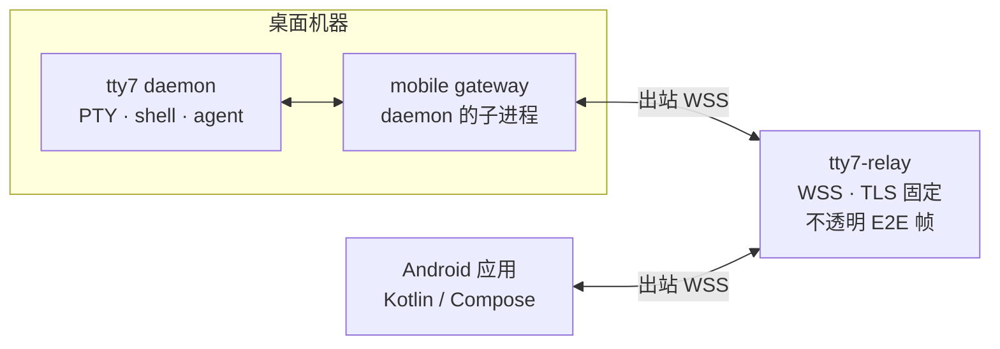

<div align="center">


<h1>tty7-plus</h1>

**桌面终端工作台，现在也能从手机接入。**

<sub>tty7 的分支 · 纯 Rust · GPU 渲染基于 Zed 的 gpui · VT 内核来自 Alacritty</sub>

<br />

[](https://github.com/l0ng-ai/tty7)
[](https://www.rust-lang.org)
[](#环境要求)
[](#android-应用)
[](LICENSE)

<sub>[English](README.md) · 简体中文</sub>

<br />

<a href="assets/tour.mp4"></a>

<sub>▶ <a href="assets/tour.mp4">观看高清版</a></sub>

</div>

> [!IMPORTANT]
> **tty7-plus 是 [l0ng-ai/tty7](https://github.com/l0ng-ai/tty7) 的社区分支。**
> 它与上游项目没有隶属关系。本仓库已禁用上游自动更新，因为上游安装包会覆盖
> 本分支并丢失定制改动。本仓库目前不发布桌面安装包，请从源码构建。详见
> [上游与维护](#上游与维护)。

## 为什么会有这个分支

tty7 把 shell 放在后台 daemon 里，而不是窗口里：关掉窗口，会话照常运行。这个
设计本身就很适合同时管理多个 coding agent 和远程机器。

tty7-plus 保留这套基础，并补上一条从手机直接连到同一个 daemon 的完整路径，
以及一个可自建的 relay。桌面端也加入了一组提高操作效率的改动：区域快捷键、
外部编辑器接管，以及会记住选择的文件树和布局偏好。

## tty7-plus 新增功能

### Android 远程终端

[`mobile/app`](mobile/app) 中的原生 Kotlin Multiplatform Compose 应用可以查看并
操作桌面上的 pane 和 agent。

- **配对**：桌面 **设置 → 配对设备** 生成五分钟有效的二维码。手机扫码后核对
  验证码，再由桌面明确批准。批准之前，手机既不能列出会话，也不能发送输入。
- **一部手机只配一台电脑**：应用记住已批准的电脑，在冷启动和回到前台时自动
  重连。要扫描另一台电脑，必须先确认解除当前配对。
- **同步终端状态，而不是回放历史 ANSI**：daemon 用与桌面相同的终端引擎解释
  PTY，只向手机发送当前屏幕快照，随后发送基于 revision 的行补丁；更早的历史
  按有界分页加载。
- **手机尺寸的 PTY**：共享终端跟随手机实测的网格尺寸，包括软键盘引起的视口
  变化。桌面「收回」后恢复桌面网格，但不会结束进程。
- **会话管理**：新建和切换工作区、新建终端，并在确认后关闭终端。关闭终端会
  结束它的 shell 和其中运行的程序，确认框会明确说明。
- **Agent 感知界面**：按仓库分组，显示分支和 agent 状态、受支持 agent 的品牌
  图标，并在会话抽屉里实时显示 agent 输出。
- **中文优先界面**，支持浅色和深色主题；两行按键栏包含回车/CR、Ctrl-J/LF、
  Esc、Ctrl-C、方向键和「更多」菜单；历史滚动按 1:1 跟手。
- **全屏程序**：竖向手势会合并远程滚轮输入，原生按键会取消排队中的滚动。
  Codex 用 Esc 回到最新输出；OMP 和普通终端在历史状态旁提供「回到底部」。
- **桌面 GUI 可以关闭**：关掉桌面窗口后 daemon 和 relay 连接继续运行。配对与
  撤销仍然是桌面侧操作。

### 自建 relay

手机通过 [`tty7-relay`](crates/tty7-relay) 连接 daemon。这是一个自行部署的
小型 Rust WebSocket relay。

- **仅 TLS**：生产连接必须使用 `wss://`。未加密的 `ws://` 只允许在显式绑定的
  本机回环地址上用于开发。
- **证书固定**：桌面保存 relay 叶证书的 SHA-256 指纹。初始空指纹会失败关闭，
  不会自动信任自签名 relay。
- **端到端加密**：配对通过 HKDF 派生双向 AES-256-GCM 密钥。relay 只转发不透明
  帧，无法读取终端内容。
- **有界设计**：连接数、host 数、每 host 客户端数、队列和帧大小都有上限；
  服务按 256 MiB 内存上限内的运行预算设计。
- **运维接口**：`/healthz` 返回 relay 健康状态；
  [`scripts/relay/tty7-relay.service`](scripts/relay/tty7-relay.service) 是加固过
  的 systemd 单元，使用 `DynamicUser` 和 `LoadCredential`。

> [!NOTE]
> 仓库不内置任何 relay 地址、证书或指纹。默认值
> `wss://relay.example.invalid:8443/v1/ws` 是保留的占位域名，不会解析。你必须
> 自备 relay 并填写它的指纹。

### 桌面工作流改动

- **区域快捷键**：<kbd>Ctrl 1</kbd> 侧边栏、<kbd>Ctrl 2</kbd> 终端区、
  <kbd>Ctrl 3</kbd> 代码面板、<kbd>Ctrl 4</kbd> 右侧面板。四个区域打开和关闭时
  以 140 ms 动画改变宽度。这些是窗口级绑定，因此 <kbd>Ctrl 2</kbd>–<kbd>Ctrl 4</kbd>
  不再向 shell 发送 NUL、ESC 和 FS；每一项都可以在 **设置 → 快捷键**（或
  `config.json` 的 `keybindings`）中改键或解绑。
- **外部编辑器**：**设置 → 通用 → 编辑器 → 文件打开方式** 可选择内置编辑器
  （默认）、Helix（`hx`）或 Vim（`vim`）。搜索命中会带上行号和列号；远程主机
  上的文件始终使用内置编辑器。
- **全局文档布局**：**文档布局** 选择 **停靠在终端旁** 或 **填满窗口**，对所有
  标签页和窗口生效，并在重启后保留。
- **文件树显示隐藏文件**：面板标题栏的眼睛图标切换 dotfile 显示，选择会以
  `files_show_hidden` 持久化。
- **工作台中的 agent 图标**：标签页和侧边栏显示 agent 图标与状态，与手机端的
  agent 标识一致。
- **禁用上游更新**：更新检查、下载和安装已在代码层和默认配置中禁用。更新本
  分支的方式是重新构建。

## 架构



桌面和手机都只发起出站连接，因此不需要公网端口或 VPN。relay 只在两者之间转发
帧；TLS 固定保护 relay 这一段，端到端加密保护跨 relay 的终端内容。

工作台的其余部分没有变化：GUI 仍是本地 daemon 的客户端，远程工作区则通过 SSH
在另一台机器上运行同一个 daemon。

## 环境要求

| | |
|---|---|
| **桌面构建** | Rust **1.95** 或更新（edition 2024）。固定的 GPUI 依赖使用 `cold_path`。 |
| **桌面运行** | macOS 14+ · Windows 10/11 · 带 X11 或 Wayland 的 Linux |
| **Linux 构建依赖** | `pkg-config cmake clang libxkbcommon-dev libxkbcommon-x11-dev libfontconfig1-dev libfreetype6-dev libwayland-dev libx11-dev libxcb1-dev libzstd-dev libssl-dev libkrb5-dev` |
| **Android 构建** | JDK 17、Android SDK 35，并设置 `ANDROID_HOME`。Gradle wrapper 已随仓库提供。 |
| **Android 运行** | Android 8.0（API 26）或更新 |
| **Relay 主机** | 任意 Linux 主机，具有公网 TCP 端口（默认 `8443`）和与 relay 主机名匹配的 TLS 证书 |

## 安装与部署

### 从源码构建桌面端

```bash
git clone https://github.com/monsoon1360/tty7-plus.git
cd tty7-plus
rustup toolchain install 1.95.0
cargo +1.95.0 build --release
./target/release/tty7-app
```

构建产物：

| 二进制 | 用途 |
|---|---|
| `target/release/tty7-app` | GUI，以及后台 daemon（`--daemon`） |
| `target/release/tty7` | 控制台 CLI，本地 daemon 的客户端 |
| `target/release/tty7-server` | 远程工作区使用的精简服务端 |
| `target/release/tty7-relay` | 手机 relay |

`tty7-app` 首次启动时会拉起 daemon。源码构建要使用 CLI 时：

```bash
export PATH="$PWD/target/release:$PATH"
tty7 --version
```

Linux 上先安装构建依赖：

```bash
sudo apt-get update
sudo apt-get install -y pkg-config cmake clang \
  libxkbcommon-dev libxkbcommon-x11-dev \
  libfontconfig1-dev libfreetype6-dev \
  libwayland-dev libx11-dev libxcb1-dev \
  libzstd-dev libssl-dev libkrb5-dev
```

macOS、Windows、Linux 和 AppImage 的打包脚本位于
[`.github/scripts`](.github/scripts)。这些是 CI 使用的脚本；每个脚本头部都写明
参数和签名前提。

更新源码安装时，拉取并重新构建，然后重启 daemon 让它运行新二进制：

```bash
git pull --ff-only
cargo +1.95.0 build --release
```

用托盘/菜单栏里的 **退出并停止 server…** 退出 tty7，再启动新构建。停止 server
会结束所有 pane 中正在运行的进程。

### Android 应用

```bash
cd mobile

# 需要安装 JDK 17 和 Android SDK 35，并让 ANDROID_HOME 指向 SDK 目录。
./gradlew :app:assembleDebug

adb install -r app/build/outputs/apk/debug/app-debug.apk
```

Debug APK 位于 `mobile/app/build/outputs/apk/debug/app-debug.apk`。应用 ID 为
`io.tty7.mobile`，`minSdk` 为 26，`compileSdk`/`targetSdk` 为 35。

[`mobile/src-tauri`](mobile/src-tauri) 中保留了旧的 Tauri/iroh 客户端，仅供开发；
**设置 → 配对设备** 和原生 Android 应用不使用它的 `tty7pair:` 协议。

### Relay 服务端

构建 relay，并连同证书一起安装：

```bash
cargo +1.95.0 build --release -p tty7-relay

sudo install -Dm755 target/release/tty7-relay /opt/tty7-relay/tty7-relay
sudo install -Dm600 /path/to/fullchain.pem  /opt/tty7-relay/tls.crt
sudo install -Dm600 /path/to/privkey.pem    /opt/tty7-relay/tls.key

sudo install -Dm644 scripts/relay/tty7-relay.service \
  /etc/systemd/system/tty7-relay.service

sudo systemctl daemon-reload
sudo systemctl enable --now tty7-relay.service
```

该单元监听 `0.0.0.0:8443`，以 `DynamicUser` 运行，并通过 systemd credentials
传入证书和私钥。替换二进制或 TLS 文件后重启：

```bash
sudo systemctl restart tty7-relay.service
```

只对 relay 放行入站 TCP `8443`。使用受信任的证书验证健康状态，不要关闭 TLS
校验：

```bash
curl --cacert /path/to/ca.pem https://relay.example.com:8443/healthz
# {"status":"ok","protocol":1}
```

计算桌面端需要的 SHA-256 指纹：

```bash
openssl x509 -in /opt/tty7-relay/tls.crt -noout -fingerprint -sha256 \
  | cut -d= -f2 | tr -d ':' | tr 'A-F' 'a-f'
```

也可以直接运行 relay 做快速验证：

```bash
target/release/tty7-relay \
  --listen 0.0.0.0:8443 \
  --cert /path/to/fullchain.pem \
  --key /path/to/privkey.pem
```

`--cert`/`--key` 分别有 `TTY7_RELAY_CERT`/`TTY7_RELAY_KEY` 环境变量，
`--listen` 有 `TTY7_RELAY_LISTEN`。除显式绑定回环地址并加上
`--allow-insecure-loopback` 的开发场景外，纯 `ws://` 会被拒绝。

> [!WARNING]
> 永远不要把证书、私钥、配对二维码、设备凭据或 relay 指纹提交到仓库。请在
> 服务器上配置证书，并通过可信的带外渠道把指纹填入桌面端。

## 配对你的手机

1. 在桌面打开 **设置 → 配对设备**。
2. 填入 relay 地址，例如 `wss://relay.example.com:8443/v1/ws`，以及叶证书的
   64 位十六进制 SHA-256 指纹。
3. 启用手机访问。空指纹会被拒绝，而不是被信任。
4. 生成二维码，五分钟内有效。
5. 在 Android 上打开 **扫描与配对管理**，按提示授予相机权限并扫码。
6. 核对手机上的验证码与桌面显示的请求，然后在桌面批准该设备。
7. 打开会话抽屉并选择终端。终端会同步到手机的网格尺寸；点击终端即可在光标
   处输入。

要收回访问权限，请在桌面撤销该设备。关闭手机访问会断开在线手机并停止 relay
访问。手机端「解除配对」只删除手机保存的凭据，本身不会撤销桌面端的设备条目。

## 配置

配置位于 `config.json`（见
[配置参考](docs/reference/configuration.mdx)）。本分支新增或修改的键：

| 键 | 值 | 默认 | 作用 |
|---|---|---|---|
| `files_show_hidden` | bool | `false` | 在文件面板显示 dotfile 和 dot 目录。切换后持久化。 |
| `file_open_with` | `"built_in"`、`"helix"`、`"vim"` | `"built_in"` | 从文件树、快速打开和搜索结果打开文件时使用的编辑器。远程文件始终使用内置编辑器。 |
| `document_layout` | `"dock"`、`"fill"` | `"dock"` | 内置编辑器和 diff 视图的全局布局，对所有标签页和窗口生效。 |
| `check_for_updates` | bool | 强制 `false` | 为配置兼容保留；上游更新检查已禁用。 |
| `auto_download_updates` | bool | 强制 `false` | 为配置兼容保留；上游更新下载已禁用。 |

## 安全与隐私

- **不内置 relay 信任**：仓库中没有部署地址，也没有证书指纹。占位主机
  `relay.example.invalid` 是保留域名，不会解析。
- **固定 + 端到端加密**：relay 这一段固定叶证书；终端内容在手机和桌面之间
  单独加密。relay 可以看到 IP、时序等连接元数据，但看不到终端内容。
- **凭据留在本地**：桌面把手机凭据保存在配置目录下的私有文件里，而不是一般
  设置中；Android 使用 Android Keystore 保存密钥。
- **显式批准**：配对请求在桌面真人批准之前不授予任何权限。配对码五分钟过期，
  且只能使用一次。
- **无上游遥测与更新**：没有账号、分析、广告或跟踪。上游更新客户端已禁用。
- **报告安全问题**：请使用本仓库的
  [私密漏洞报告](https://github.com/monsoon1360/tty7-plus/security/advisories/new)，
  不要为安全问题开公开 issue。

[`PRIVACY.md`](PRIVACY.md) 中的继承隐私政策仍描述旧的 iroh 开发客户端。原生
Android 路径的权威说明见
[docs/remote/workspaces.mdx](docs/remote/workspaces.mdx#android-remote-terminals)。

## 继承自 tty7

- **会话常驻**：shell 和 pane 属于后台 daemon，关闭窗口不会结束它们。重新接入
  时布局和屏幕内容仍在，受支持的 agent 在重启后继续原对话。
- **Agent 感知**：逐 pane 识别 28 个 coding CLI，显示状态点、通知、分支和 diff
  上下文、托盘提醒，并提供面向 agent 的编排 CLI（`tty7 split`、`send`、
  `wait`、`capture`）。
- **编辑器级输入**：历史建议、带说明的补全、语法高亮、多行编辑和模糊历史搜索。
- **远程工作区**：原生 Rust SSH 栈，支持 profile、keychain 凭据、跳板机、SFTP、
  端口转发，以及在远端无需 root 的一次性 `tty7-server` 安装。
- **工作台**：标签页与分屏、随处搜索、回滚搜索、休眠、带监听端口的进程树、
  源码管理、文件内搜索，以及只读 GitHub 面板。

完整文档见 [docs/](docs/)，包括
[快捷键](docs/reference/keyboard-shortcuts.mdx)、
[配置参考](docs/reference/configuration.mdx)、
[CLI 参考](docs/cli/reference.mdx) 和
[远程工作区](docs/remote/workspaces.mdx)。

## 上游与维护

上游项目是 [l0ng-ai/tty7](https://github.com/l0ng-ai/tty7)。本分支有选择地
跟随上游：

```bash
git remote add upstream https://github.com/l0ng-ai/tty7.git
git fetch upstream
git merge upstream/main
```

预期在以下文件出现冲突：本分支刻意修改的更新客户端、配置默认值、Android 应用
与 relay crate、设置页面和侧边面板。合并后运行工作区测试，并重新确认
`UPDATES_ENABLED` 仍为 `false`，且没有引入 relay 地址或指纹：

```bash
cargo +1.95.0 test --workspace
```

除非你打算发布本分支自己的安装包并让更新器指向它们，否则请保持更新器禁用。

## 贡献

欢迎在 [monsoon1360/tty7-plus](https://github.com/monsoon1360/tty7-plus/issues)
提交 issue 和 pull request。如果改动同样适用于上游，也建议一并提交给上游。

提交 PR 之前：

```bash
cargo +1.95.0 fmt --all -- --check
cargo +1.95.0 clippy --workspace --all-targets
cargo +1.95.0 test --workspace
```

修改手机应用时：

```bash
cd mobile
./gradlew :app:testDebugUnitTest
```

## 许可证

[Apache-2.0](LICENSE)。tty7-plus 是 tty7 的分支；原始作品版权归其贡献者所有。

---

<div align="center">
<sub>

基于 [gpui](https://github.com/zed-industries/zed) 和
[`alacritty_terminal`](https://github.com/zed-industries/alacritty) 构建 ·
[更新日志](CHANGELOG.md) · [上游 tty7](https://github.com/l0ng-ai/tty7)

</sub>
</div>
